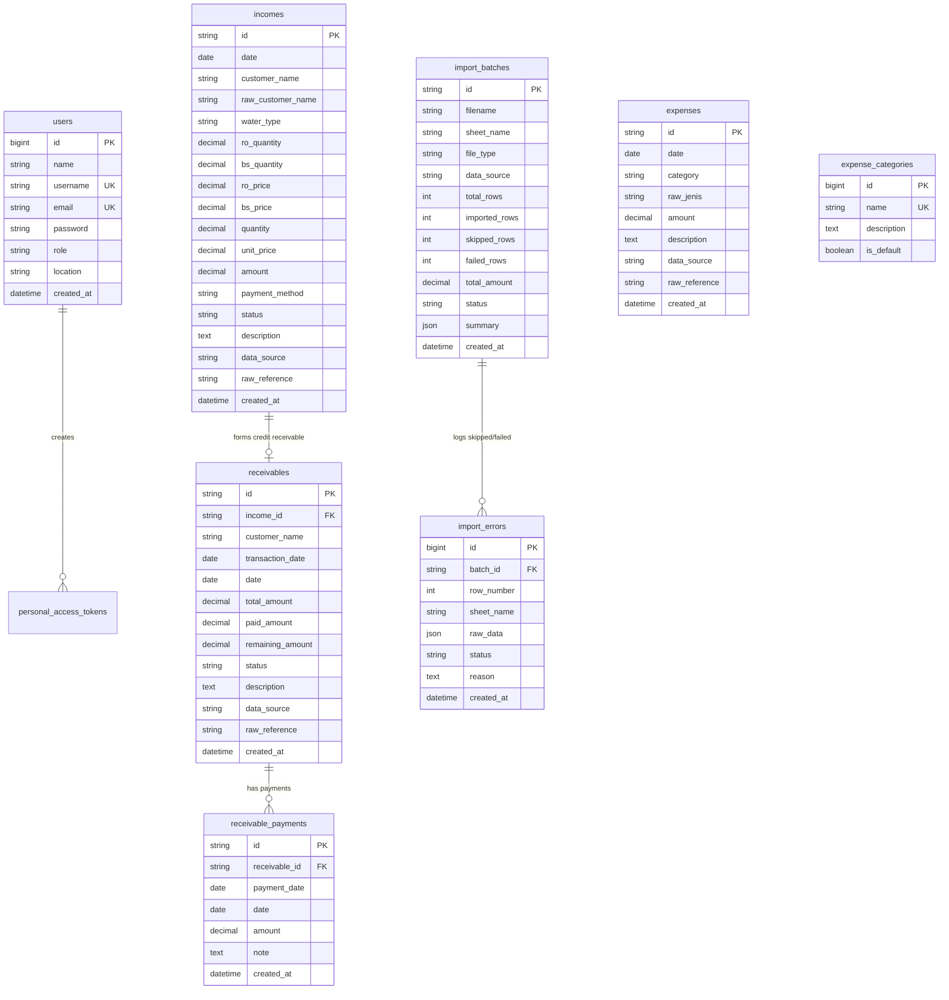

# Backend REST API UMKM RAJASH (Laravel)

Repositori backend REST API untuk **Sistem Pengelolaan Keuangan dan Piutang UMKM RAJASH** (Ulee Kareng, Banda Aceh).
Dibangun menggunakan **Laravel 12**, **MySQL**, dan **Laravel Sanctum**.

- **Program:** Asah 2026 - Dicoding x GoTo
- **ID Tim:** A26-CS148
- **Backend Engineer:** Reinald Oryza Apriancahya
- **Frontend Engineer / UI/UX:** Brian Dicky Vanka Andaraneva

---

## 1. Prasyarat Sistem
- PHP >= 8.2 (dengan ekstensi `pdo_mysql`, `mbstring`, `openssl`, `bcmath`, `curl`)
- Composer >= 2.x
- MySQL Server (misal via XAMPP atau MySQL Service di port `3306`)

---

## 2. Cara Menjalankan Server Backend

1. Buka terminal di folder `backend`:
   ```bash
   cd backend
   ```
2. Pastikan file `.env` sudah sesuai dengan kredensial MySQL lokal Anda:
   ```env
   DB_CONNECTION=mysql
   DB_HOST=127.0.0.1
   DB_PORT=3306
   DB_DATABASE=rajash_keuangan
   DB_USERNAME=root
   DB_PASSWORD=
   ```
3. Jalankan migrasi:
   ```bash
   php artisan migrate
   ```
4. Jalankan perintah import dataset Excel (idempotent):
   ```bash
   php artisan rajash:import-dataset
   ```
5. Jalankan server lokal Laravel:
   ```bash
   php artisan serve
   ```
   Server backend akan aktif di: `http://localhost:8000`

---

## 3. Akun Pemilik Default
- **Username:** `owner.rajash`
- **Email:** `dedy@rajash-depot.id`
- **Password:** `rajash2026`
- **Nama:** `Dedy Darmansyah`
- **Role:** `Owner UMKM RAJASH`

---

## 4. Entity Relationship Diagram (ERD)



---

## 5. Sumber Data (Data Source)
Setiap transaksi keuangan memiliki kolom `data_source`:
- `real`: Data pengeluaran aktual depot RAJASH periode 23 Agustus 2026 – 23 Oktober 2026 (88 baris valid dari `Dataset Pengeluaran-1.xlsx`). *(Catatan: dataset pemasukan aktual untuk periode ini belum tersedia dari UMKM).*
- `synthetic`: Data historis sintetis periode 23 April 2026 – 22 Agustus 2026 (2.408 pemasukan dan 211 pengeluaran dari `Data_Sintetis_Rajash.xlsx`).
- `application`: Data transaksi yang diinput langsung melalui aplikasi web / API.

---

## 6. Daftar Endpoint REST API

| Method | Endpoint | Deskripsi | Autentikasi |
|---|---|---|---|
| `GET` | `/api/health` | Healthcheck server API | Publik |
| `POST` | `/api/auth/login` | Login owner & penerbitan Bearer token | Publik |
| `POST` | `/api/auth/logout` | Revoke token sesi | Bearer Token |
| `GET` | `/api/auth/me` | Profil pengguna aktif | Bearer Token |
| `GET` | `/api/dashboard` | Ringkasan metrik, grafik & transaksi | Bearer Token |
| `GET` | `/api/incomes` | Riwayat pencatatan pemasukan | Bearer Token |
| `POST` | `/api/incomes/check-duplicate` | Deteksi potensi input transaksi ganda | Bearer Token |
| `POST` | `/api/incomes` | Tambah pemasukan (otomatis buat piutang jika Kredit) | Bearer Token |
| `DELETE` | `/api/incomes/{id}` | Hapus transaksi pemasukan | Bearer Token |
| `GET` | `/api/expense-categories` | Daftar 9 kategori pengeluaran dinamis | Bearer Token |
| `GET` | `/api/expenses` | Riwayat biaya operasional | Bearer Token |
| `POST` | `/api/expenses` | Tambah biaya operasional | Bearer Token |
| `DELETE` | `/api/expenses/{id}` | Hapus biaya operasional | Bearer Token |
| `GET` | `/api/receivables` | Daftar piutang pelanggan | Bearer Token |
| `GET` | `/api/receivables/{id}` | Detail piutang & riwayat pembayaran | Bearer Token |
| `POST` | `/api/receivables/{id}/payments` | Catat pembayaran piutang (penuh/cicil) | Bearer Token |
| `GET` | `/api/recapitulation` | Rekapitulasi harian & bulanan buku besar | Bearer Token |
| `GET` | `/api/import-batches` | Riwayat batch import dataset & skipped log | Bearer Token |

---

## 7. Skrip Pengujian & Verifikasi
Jalankan skrip pembantu di folder `backend`:
- Uji validasi database vs Excel:
  ```bash
  php scripts/validate_database.php
  ```
- Uji seluruh test suite REST API:
  ```bash
  php scripts/test_full_suite.php
  ```
